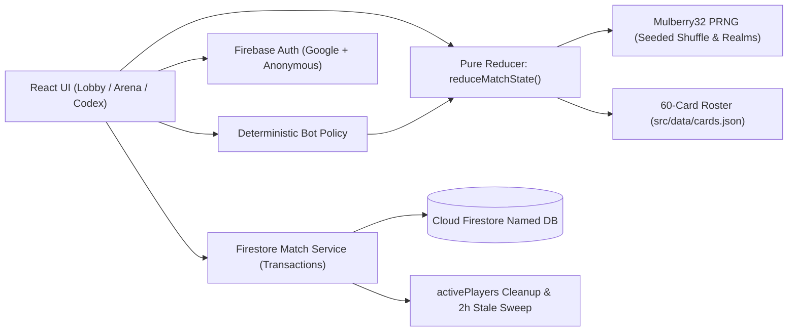

# Pantheon Clash — Mythology Trump Card Game


A deterministic **Mythology Trump Card** web game built with Vite, React, TypeScript, Tailwind CSS, and Firebase (Authentication + Cloud Firestore), configured for static hosting on GitHub Pages.

Zero runtime AI or LLM calls are used anywhere in the application—deck shuffling, rotating realms, prophecy hints, and bot tactics are 100% deterministic via a seeded **Mulberry32** PRNG.

## Architecture



## Game Mechanics

- **60-Deity Roster**: Seven pantheons (`Greek`, `Norse`, `Hindu`, `Egyptian`, `Japanese`, `Celtic`, `Mesoamerican`) split 30 vs 30 from a seeded Mulberry32 shuffle.
- **Four Stats**: `Might`, `Arcana`, `Cunning`, and `Influence`.
- **Rotating Realms**: Every 3 rounds, the active realm cycles deterministically across `SKY`, `UNDERWORLD`, `SEA`, and `WAR`, granting `+15` to matching-domain cards.
- **Tactical Passives**:
  - **Piercing**: Ignores the opponent's `+15` realm bonus.
  - **Prophecy**: Deterministically reveals one stat of the opponent's top card before choosing.
  - **Resurrection**: Once per match, returns a losing card to the bottom of its owner's deck instead of forfeiting it.
- **Gambit (Once per Match)**: Inverts the round comparison so the lowest effective stat wins.
- **War Pot Ties**: Equal effective stats move both cards into `warPot`, claimed by the next round's winner.

## Local Development

```bash
npm install --legacy-peer-deps
npm run dev
```

To enable 2-Player Online Arena locally with Firebase Auth & Cloud Firestore, copy `.env.example` to `.env.local` and set `VITE_FIREBASE_API_KEY` (`.env*` and `firebase-applet-config.json` are gitignored so no API key is committed or bundled into public GitHub Pages builds).

### Verification & Testing

```bash
npm run lint
npm test
npm run build
```

## GitHub Pages Deployment

The included `.github/workflows/deploy.yml` workflow builds, tests, and deploys `dist/` to GitHub Pages on every push to `main` using Node.js 22 and `vite.config.ts` (`base: './'`). Solo vs. Deterministic Bot, the 60-card Codex, and Rules run 100% client-side with zero API keys in the repository or bundle.
