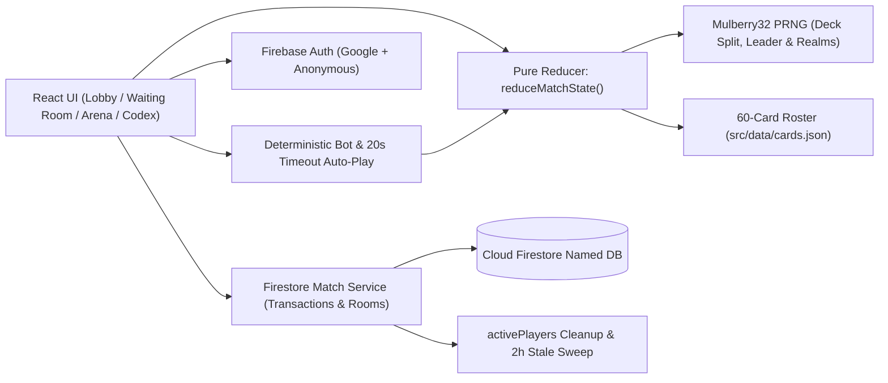

# Pantheon Clash — Mythology Trump Card Game


A deterministic **Mythology Trump Card** web game for **2–4 players** built with Vite, React, TypeScript, Tailwind CSS, and Firebase (Authentication + Cloud Firestore), configured for static hosting on GitHub Pages.

Zero runtime AI or LLM calls are used anywhere in the application—deck shuffling, Round 1 leader selection, rotating realms, prophecy hints, and bot tactics are 100% deterministic via a seeded **Mulberry32** PRNG.

## Architecture



## Game Mechanics

- **60-Deity Roster & 2–4 Player Splits**: Seven pantheons (`Greek`, `Norse`, `Hindu`, `Egyptian`, `Japanese`, `Celtic`, `Mesoamerican`) split evenly (`30/30`, `20/20/20`, or `15/15/15/15`) from a seeded Mulberry32 shuffle. Optional **2v2 Teams** mode pairs seats `1 & 3` vs `2 & 4`.
- **Four Stats**: `Might`, `Arcana`, `Cunning`, and `Influence`.
- **Rotating Realms**: Every 3 rounds, the active realm cycles deterministically across `SKY`, `UNDERWORLD`, `SEA`, and `WAR`, granting `+15` to matching-domain cards.
- **Tactical Passives**:
  - **Piercing**: Ignores the `+15` realm bonus on all opponents' cards during the clash.
  - **Prophecy**: Lets the active player choose an opponent and deterministically reveal one stat of their top card before picking.
  - **Resurrection**: Once per match per player, returns a losing card to the bottom of its owner's deck instead of forfeiting it.
- **Gambit (Once per Match)**: Inverts the clash so the lowest effective stat wins across all players.
- **War Pot Ties, Round Cap & Turn Timer**: Tied top contenders move all played cards into `warPot` and rotate turns clockwise. Eliminations occur at 0 cards; matches also conclude after `60` rounds by highest card count (or combined team count in 2v2). Online turns enforce a 20-second timer with Away/Rejoin recovery.

## Local Development

```bash
npm install --legacy-peer-deps
npm run dev
```

To enable Online Multiplayer Rooms locally with Firebase Auth & Cloud Firestore, copy `.env.example` to `.env.local` and set `VITE_FIREBASE_API_KEY` (`.env*` and `firebase-applet-config.json` are gitignored so no API key is committed or bundled into public GitHub Pages builds).

### Verification & Testing

```bash
npm run lint
npm test
npm run build
npx eslint firestore.rules
```

## GitHub Pages Deployment

The included `.github/workflows/deploy.yml` workflow builds, tests, and deploys `dist/` to GitHub Pages on every push to `main` using Node.js 22 and `vite.config.ts` (`base: './'`). Solo vs. Deterministic Bot (2–4 players), the 60-card Codex, and How to Play work 100% client-side with zero API keys in the repository or bundle.
